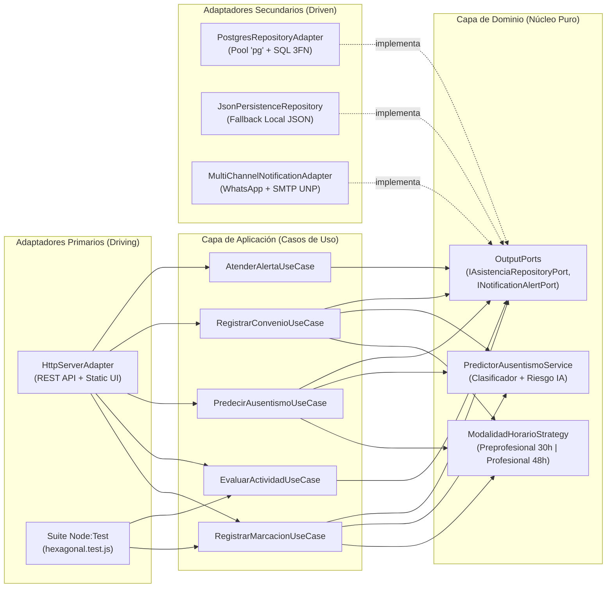

# 01. Arquitectura Hexagonal y Capas del Backend

El backend de **SICA - CIT UNP** (`backend/src/`) fue construido aplicando **Arquitectura Hexagonal (Puertos y Adaptadores)** de Alistair Cockburn junto con los principios **SOLID** y patrones de diseño **GoF (Strategy, Factory Method, Repository, Adapter y Composite)**.

---

## 1. Diagrama de Componentes e Inyección de Dependencias



---

## 2. Punto de Ensamblaje (*Composition Root*): `backend/src/main.js`

El archivo `backend/src/main.js` implementa el **Principio de Inversión de Dependencias (SOLID - DIP)** a través de la función `buildContainer(customDbPath = null)`:

```javascript
function buildContainer(customDbPath = null) {
    const usePostgres = !customDbPath && Boolean(process.env.DATABASE_URL);
    const asistenciaRepository = usePostgres
        ? new PostgresRepositoryAdapter(process.env.DATABASE_URL)
        : new JsonPersistenceRepository(customDbPath);

    const notificationPort = new MultiChannelNotificationAdapter();
    // Inyección en los 5 Casos de Uso...
}
```

* **Conmutación transparente de base de datos:** Ningún Caso de Uso ni servicio de Dominio conoce si los datos provienen de PostgreSQL o de un archivo JSON. Si `process.env.DATABASE_URL` está definido (como en Railway), se inyecta `PostgresRepositoryAdapter`. Si se ejecuta un test unitario pasando un `customDbPath` temporal en `/tmp`, se inyecta `JsonPersistenceRepository`.

---

## 3. Capa de Dominio (`backend/src/domain/`)

La capa de dominio no importa librerías de red, ni `fs`, ni `http`, ni `pg`. Contiene exclusivamente las reglas institucionales de la UNP y de la **Ley N.° 28518** (Ley sobre Modalidades Formativas Laborales).

### 3.1. Patrón *Strategy* + *Factory*: `ModalidadHorarioStrategy.js`
Resuelve las diferencias normativas entre practicantes preprofesionales y profesionales sin usar condicionales `if/else` dispersos:

| Clase Estrategia | Modalidad | Tope Diario | Tope Semanal | Meta Convenio | Método `validarHorasSesion(horasSemanaActual, horasSolicitadas)` |
| :--- | :--- | :---: | :---: | :---: | :--- |
| `PreprofesionalStrategy` | `PREPROFESIONAL` | `6 h` | `30 h` | `360 h` | Recorta automáticamente las horas válidas de la sesión si `horasSemanaActual + horasSolicitadas > 30` e informa `excedeTopeSemanal: true`. |
| `ProfesionalStrategy` | `PROFESIONAL` | `8 h` | `48 h` | `480 h` | Recorta las horas válidas si superan `8 h` diarias o `48 h` semanales. |

### 3.2. Servicio de Dominio: `PredictorAusentismoService.js`
Contiene dos algoritmos estáticos deterministas y trazables:
1. **`clasificarIngreso(horaProgramadaStr, horaRealStr, toleranciaMin = 10)`:**
   * Convierte ambas horas (`HH:MM`) a minutos desde la medianoche.
   * Si `retraso <= toleranciaMin` (10 minutos en el CIT - UNP), retorna `{ estadoAsistencia: "PUNTUAL", minutosTardanza: 0, disparaAlerta: false }`.
   * Si `retraso > toleranciaMin`, retorna `{ estadoAsistencia: "TARDANZA", minutosTardanza: retraso, disparaAlerta: true }`.
2. **`evaluarRiesgoYProyeccion(practicante, esSemanaExamenesUnp = false)`:**
   * Calcula la probabilidad de ausentismo ponderando:
     $$\text{Score} = \min\left(98, \max\left(5, \text{round}\big((100 - \text{Puntualidad})\times 0.8 + \text{Tardanzas}\times 6 + \text{Faltas}\times 15 + \text{PenalidadExámenes}\big)\right)\right)$$
   * Donde $\text{PenalidadExámenes} = 18$ cuando `esSemanaExamenesUnp === true` y la modalidad es `PREPROFESIONAL` (debido al cruce con evaluaciones parciales/finales en la UNP).
   * Clasifica el semáforo en:
     * `ROJO` ($\ge 65\%$): Riesgo crítico.
     * `AMBAR` ($35\% - 64\%$): Riesgo preventivo.
     * `VERDE` ($< 35\%$): Nivel óptimo.
   * Calcula la **fecha de culminación proyectada** (`fechaFinProyectada`) dividiendo las horas restantes (`metaHoras - horasAcumuladas`) entre el ritmo real de horas semanales del practicante.

### 3.3. Puertos de Salida (`OutputPorts.js`)
Define las clases abstractas `IAsistenciaRepositoryPort` (10 métodos asíncronos de persistencia) e `INotificationAlertPort` (`enviarAlertaMulticanal`).

---

## 4. Capa de Aplicación (`backend/src/application/use-cases/`)

Cada caso de uso encapsula una operación de negocio completa del CIT - UNP:

1. **`RegistrarMarcacionUseCase.js`:**
   * **En `ENTRADA`:** Invoca a `PredictorAusentismoService.clasificarIngreso()`. Actualiza `horaEntradaHoy` y `estadoHoy`. Si hay tardanza ($> 10\text{ min}$), incrementa `tardanzasMes`, dispara la notificación automática vía `notificationPort.enviarAlertaMulticanal()` y persiste la alerta y el practicante.
   * **En `SALIDA`:** Exige que `descripcionActividad` no esté vacía. Valida las horas solicitadas con la estrategia de la modalidad (`ModalidadStrategyFactory`), suma las horas válidas a `horasSemanaActual` y `horasAcumuladas`, guarda la actividad en estado `PENDIENTE_REVISION` y verifica si el practicante superó el $90\%$ de su meta de horas para emitir una alerta de proximidad de constancia.
2. **`EvaluarActividadUseCase.js`:**
   * Recibe `{ actividadId, estadoRevision, calificacion, observacionSupervisor }`.
   * Normaliza la calificación entre `1` y `5`, actualiza la actividad (`APROBADA` u `OBSERVADA`) y recalcula automáticamente el `promedioEvaluacionActividades` del practicante a partir de todas sus actividades calificadas.
   * Si el dictamen es `OBSERVADA`, emite automáticamente una alerta multicanal al practicante solicitando la subsanación.
3. **`PredecirAusentismoUseCase` (`GestionarConveniosYAlertasUseCase.js`):**
   * Ejecuta `PredictorAusentismoService.evaluarRiesgoYProyeccion()`, actualiza el score y semáforo del practicante en la base de datos y despacha una alerta preventiva a supervisión y al practicante.
4. **`RegistrarConvenioUseCase` (`GestionarConveniosYAlertasUseCase.js`):**
   * Obtiene la estrategia según la modalidad (`PREPROFESIONAL` o `PROFESIONAL`), asigna automáticamente los topes legales de ley (`6h/30h/360h` o `8h/48h/480h`) e inserta el nuevo practicante en el repositorio.
5. **`AtenderAlertaUseCase` (`GestionarConveniosYAlertasUseCase.js`):**
   * Registra la confirmación de atención de una alerta por parte del supervisor, estampando la hora oficial (`HH:MM`) y la resolución tomada.
